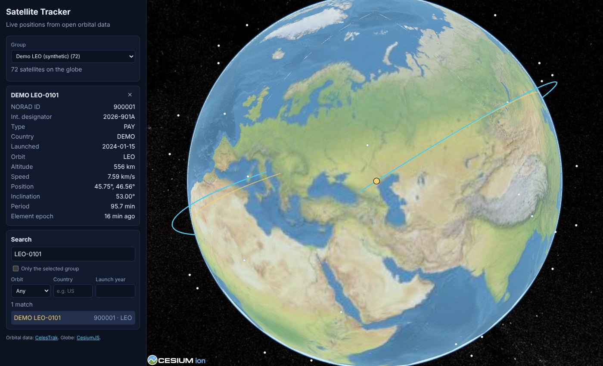

# Satellite Tracker

A real-time 3D map of satellites built from open data. A small backend downloads orbital
elements from [CelesTrak](https://celestrak.org) on CelesTrak's 2-hour update cycle and
serves them over a REST API. The browser propagates every orbit with SGP4 in a Web Worker
and draws it on a CesiumJS globe, with search, filters, orbit paths and ground tracks.

**Owner:** [@cosmo030](https://github.com/cosmo030) · **Status:** MVP, in development · **License:** [MIT](LICENSE)



## Features

- Live positions of a satellite group (space stations, GPS, Galileo, weather, ...) on a 3D globe
- Search by name or NORAD ID; filter by orbit class (LEO/MEO/GEO/HEO), country and launch year
- Details for the selected satellite: altitude, speed, position, inclination, period, element age
- Orbit path and ground track for the selected satellite
- Warning when orbital elements are more than 3 days old
- An ingest worker that follows the [CelesTrak usage policy](https://celestrak.org/usage-policy.php):
  one download per group per update, and a full stop on any non-200 response

## Quick Start

With Docker installed:

```bash
cp .env.example .env               # then set POSTGRES_PASSWORD (and the same value in the URLs)
docker compose up -d --build
```

Open <http://localhost:8080>. The ingest worker downloads the first data within a minute.

## Prerequisites

| Tool | Version | Used for |
|---|---|---|
| Python | 3.13 (see `backend/.python-version`) | Backend |
| [uv](https://docs.astral.sh/uv/) | 0.11 or newer | Python dependencies |
| Node.js | 22 (see `.nvmrc`) | Frontend |
| Docker with Compose | Docker 24 or newer | Local PostgreSQL, full stack |
| GNU Make | any | Command shortcuts |

On Windows, use WSL 2 for `make`.

## Development Setup

1. Copy the example configuration and choose a local database password:

   ```bash
   cp .env.example .env
   ```

   Replace every `<CHOOSE_A_LOCAL_PASSWORD>` in `.env` with the same value.

2. Install dependencies and start PostgreSQL:

   ```bash
   make install
   make db-up
   make migrate
   ```

3. Load data, either live from CelesTrak or a synthetic demo set that needs no network:

   ```bash
   make run-ingest    # live data from CelesTrak
   make seed          # or: synthetic demo satellites
   ```

4. Start the API and the frontend in two terminals:

   ```bash
   make run-api       # http://localhost:8000/api/docs
   make run-web       # http://localhost:5173
   ```

5. Run every check before you push:

   ```bash
   make check
   ```

## Commands

Run `make help` for the full list. The most used:

| Command | What it does |
|---|---|
| `make check` | Format check, lint, type check, all tests, production build (what CI runs) |
| `make format` | Format backend and frontend code |
| `make test` | Backend and frontend tests; integration tests need `SATTRACK_TEST_DATABASE_URL` |
| `make openapi` | Regenerate `docs/openapi.json` after API changes |

## Configuration

All settings are environment variables, documented in [docs/configuration.md](docs/configuration.md)
and listed with examples in [.env.example](.env.example).

## Project Structure

```text
backend/            FastAPI app, ingest worker, Alembic migrations, tests
  src/sattrack/     catalog/ (satellites, element sets, API), ingest/ (CelesTrak), health/
frontend/           React + TypeScript app with CesiumJS and satellite.js
docs/               Architecture, ADRs, API spec, configuration, runbook
scripts/            Database init script for docker compose
```

## Deployment

The app ships as two container images run with `docker compose`. See the
[runbook](docs/runbook.md) for deployment, health checks, backups and rollback.

## Further Documentation

- [Architecture overview](docs/architecture.md) and [decision records](docs/adr/)
- [API reference](docs/api.md) ([OpenAPI spec](docs/openapi.json))
- [Contributing guide](CONTRIBUTING.md) · [Security policy](SECURITY.md) · [Changelog](CHANGELOG.md)

## Data and Credits

Orbital data comes from [CelesTrak](https://celestrak.org), run by Dr. T.S. Kelso as a
non-profit. Please respect its usage policy; consider [supporting it](https://celestrak.org).
The globe uses [CesiumJS](https://cesium.com/platform/cesiumjs/) (Apache-2.0) with its bundled
Natural Earth II imagery, and orbits are computed with [satellite.js](https://github.com/shashwatak/satellite-js) (MIT).
