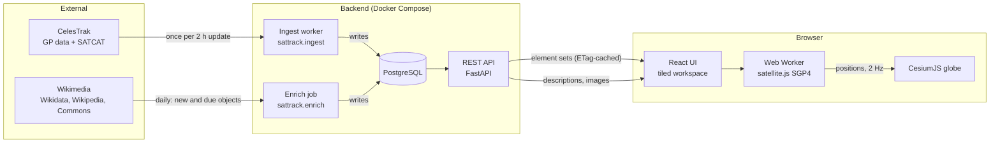

# Architecture

Satellite Tracker shows where satellites are right now. It is used by anyone with a browser;
there are no accounts and no personal data. The server only distributes public orbital
elements and openly licensed descriptions and images; every position is computed in the
visitor's browser.

## Components

| Component | Location | Responsibility |
|---|---|---|
| Ingest worker | `backend/src/sattrack/ingest/` | The only code that calls CelesTrak. Fetches each configured group at most once per 2-hour update, SATCAT metadata once a day, logs every request in `fetch_log`, and stops on any non-200 response with exponential back-off (2 h to 24 h). |
| Enrich job | `backend/src/sattrack/enrich/` | The only code that calls Wikimedia. Runs in the worker process (a daily pass over new and refresh-due objects; full refresh every 7 days) and from `make run-enrich`. Matches objects on Wikidata, takes text from Wikipedia and freely licensed images from Commons, one request at a time with an identifying User-Agent; stops on any 5xx or unexpected response. |
| Catalog | `backend/src/sattrack/catalog/` | Domain types and rules (orbit classification), data access for satellites, element sets, groups, descriptions and images, and the catalog HTTP routes. |
| Health | `backend/src/sattrack/health/` | `/api/v1/health`: database reachability and data freshness. |
| Web frontend | `frontend/src/` | React UI. `components/` holds the tiles and the resizable workspace (react-resizable-panels); `ui/` holds pure layout, skin, placement and catalog helpers; `orbit/` holds SGP4 propagation (pure functions) and the worker; `globe/` wraps CesiumJS and places its canvas under the viewport tile; `hooks/` loads data from the API and tracks skin and screen size. |

Backend modules depend on each other only through their package `__init__` exports.
`ingest` and `enrich` write catalog data through `CatalogRepository`; `health` reads freshness
through `ingest.get_data_status`. Ingest and enrich take the same PostgreSQL advisory lock, so
they never write at the same time.

## Data

| Table | Owner | Content |
|---|---|---|
| `satellites` | catalog | One row per object: name, designator, type, country, launch date, orbit class |
| `orbital_elements` | catalog | Every element set received (history), with the raw OMM JSON |
| `groups`, `satellite_groups` | catalog | CelesTrak groups and their members |
| `fetch_log` | ingest | Every upstream request: URL, status, record counts, error |
| `satellite_about` | catalog (written by enrich) | Per object: match status, Wikidata item, description and its source, purpose categories, operators, manufacturers |
| `satellite_image` | catalog (written by enrich) | 480 and 960 px JPEG/PNG thumbnails from Commons with author, license and source page |

Element sets are never updated in place; a new epoch is a new row. All timestamps are stored
and exchanged in UTC (ISO 8601).

## Key Decisions

- Positions are computed in the browser, not on the server ([ADR 0002](adr/0002-propagate-orbits-in-the-browser.md)).
- One service owns all CelesTrak traffic ([ADR 0003](adr/0003-single-ingest-service-for-celestrak.md)).
- CesiumWidget with offline imagery, so no Cesium ion token and a strict CSP ([ADR 0004](adr/0004-cesiumwidget-with-offline-imagery.md)).
- Stack and repository layout ([ADR 0001](adr/0001-initial-stack-and-structure.md)).
- A tiled, resizable workspace with Instrument and Frosted glass skins ([ADR 0005](adr/0005-tiled-workspace-and-skins.md)).
  Layout and skin preferences are stored in the browser (`localStorage`), never on the server.
- Descriptions and images come from Wikimedia, fetched and hosted by the backend so the browser
  never contacts Wikimedia ([ADR 0006](adr/0006-wikimedia-descriptions-and-images.md)).

## Deployment

Two container images (backend, web) plus PostgreSQL, run with `docker compose`. Caddy in the
web image serves the static frontend and proxies `/api` to the API container, so browser and
API share one origin. See the [runbook](runbook.md).
